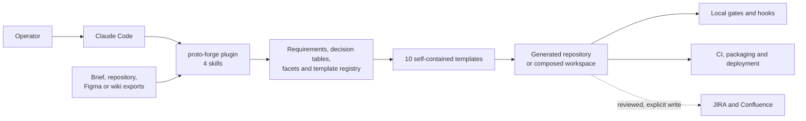
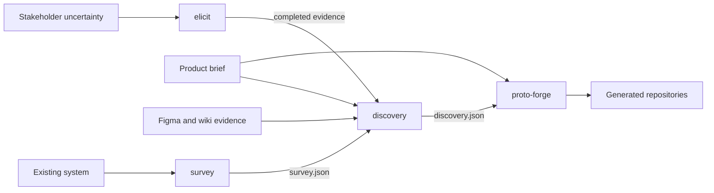
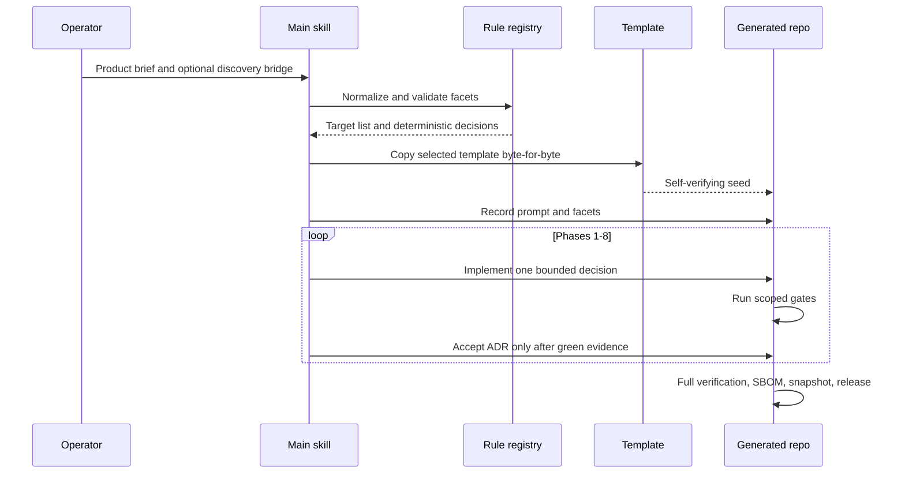

# Architecture

## Purpose

proto-forge is a specification-driven code generator packaged as four Claude Code
skills. It does not use a generator executable or a central runtime service. The
main skill interprets a brief according to versioned rules, copies one or more
template trees, and then changes the copied repositories under a gated workflow.

The architecture optimizes for four properties:

- structural determinism: equal normalized facets select the same repositories,
  ADR bands, and file skeletons;
- standalone output: every generated repository verifies without importing files
  from the plugin repository;
- evidence before claims: rules cite requirements, gates demonstrate failure
  cases, and status documents are derived from machine output;
- controlled divergence: shared template assets are copied for independence, then
  checked byte-for-byte where they are intended to remain identical.

## System context



The optional external integrations are not part of generation. They stage payloads
locally by default; live writes require enabled integration configuration, allowed
network access, explicit commit/approval flags, and environment-provided credentials.

## Repository containers

| Container | Responsibility | Primary sources |
| --- | --- | --- |
| Skill layer | Select a workflow and define its deterministic procedure. | `SKILL.md`, `skills/*/SKILL.md` |
| Normative layer | Define requirements, facet normalization, decisions, templates, and security controls. | `references/` |
| Template layer | Provide complete, independently verifiable application seeds. | `templates/*/` |
| Plugin gate layer | Check manifests, citations, copied standards, template pins, and shared files. | `scripts/` and root `package.json` |
| Distribution layer | Expose one installable plugin containing four skills. | `.claude-plugin/` and `plugin/.claude-plugin/` |
| Decision history | Explain why the plugin and seed changed. | `docs/adr/`, `docs/specs/`, `docs/plans/` |

The root scripts deliberately do not import template scripts. Root gates reason
about the plugin repository; template gates run inside a generated application.
This boundary prevents a copied application from depending on its generator.

## Skill topology



- `proto-forge` creates a new web, backend, desktop, or composed application.
- `discovery` produces English SPIN/DAPA gap-analysis documents and a bridge with
  source pins and reserved test IDs.
- `survey` inventories an existing system. Every capability and unknown cites file
  and line evidence and declares whether it was observed or inferred.
- `elicit` selects and generates an unfinished stakeholder instrument. It is a way
  to obtain evidence, not an alternative requirements form.

Each skill has a manifest with the plugin version. `skill:lint` checks registration,
name uniqueness, frontmatter, version agreement, and unsupported external pointers.

## Main generation flow



Phase 0 is the only interpretive phase. Later choices must resolve through the
decision table or through a recorded escalation. The prompt log is append-only and
the normalized facet document plus its version forms the brief identity.

For a backend brief, generation creates a workspace repository and nested, separate
Git repositories. The API is generated first so its OpenAPI contract can be consumed
by the UI and cross-application E2E layer. `workspace.json` owns part membership;
the workspace repository ignores the part directories so their histories remain
independent.

## Template selection

The canonical registry is `references/templates.json`. The current target set is:

- one web frontend;
- five backend stacks: Node/Fastify, Python/FastAPI, Java/Spring Boot,
  Kotlin/Ktor, and C#/ASP.NET Core;
- two desktop shells: Tauri and Electron;
- a workspace orchestrator and a cross-application E2E repository.

Backend architecture is derived, not selected by taste:

1. Hexagonal when there are at least three external systems or broker messaging.
2. Modular monolith when the entity graph has at least two connected components or
   at least eight entities.
3. Layered architecture otherwise.

The derivation is written to `.proto-forge/architecture.json`; each backend's
`arch:verify` gate independently re-derives the expected style and checks dependency
direction. A brief that demands an incompatible style is escalated rather than
silently overriding the rule.

## Generated frontend and desktop structure

The web and desktop templates share the same application architecture:

```text
src/app/                 routing, shell, error boundary
src/domain/              schemas, inferred models, repository ports
src/features/            user-facing slices
src/infra/               real local or API adapters and seed data
src/i18n/                locale registry and catalogues
src/harness/             component states used by docs and browser tests
src/shared/              cross-cutting application code, including SafeHtml
packages/proto-ui/       owned, byte-pinned component library
e2e/                     Playwright behavior, keyboard, axe, and overlay proofs
docs/                    architecture, security, delivery, ADRs, and catalogues
```

Dependencies point from features toward domain ports and owned UI primitives.
Infrastructure implements domain ports. User-visible strings come from the locale
catalogues. Overlays use the owned top-layer/portal implementation rather than local
z-index conventions. Desktop templates add a thin shell while retaining the web
application and its gates.

## Generated backend structure

Language-specific directory names differ, but the logical elements are stable:

- inbound adapters or controllers are derived from a route registry;
- application services implement use cases;
- the domain owns models and repository contracts;
- outbound adapters implement persistence and external-system ports;
- the platform kernel owns configuration, logging, security headers, health,
  problem details, and documentation serving where implemented;
- append-only migrations own schema evolution;
- `contract/openapi.json` is generated and locked, not hand-edited.

Every operation has a deterministic operation ID and registered problem types.
Examples are captured from executable scenarios. Architecture checks use the native
mechanism of each stack plus a repository gate where appropriate.

## Verification architecture

There are three verification scopes:

| Scope | Command or mechanism | What it protects |
| --- | --- | --- |
| Plugin | `pnpm selftest` and `pnpm verify` | Skill metadata, citations, control catalogue, registry, seed pins, shared files, and skill mini-templates. |
| Template source | `node scripts/verify-template.mjs --template <id>` | A scratch copy installs and passes that template's own full verification. |
| Generated repository | Its own `pnpm verify:fast` and `pnpm verify` | Product behavior and the template-specific quality contract. |

The root CI reads the template matrix from the registry, installs stack-specific
toolchains, and verifies every template in isolation. Generated projects retain
their own workflows and do not call back to this repository.

See [Verification](VERIFICATION.md) for proof boundaries.

## Security and trust boundaries

- Briefs, design exports, API responses, environment variables, integration data,
  and repository content are untrusted inputs.
- Secrets are referenced by environment-variable name and are redacted from prompt
  logs. Secret and dependency scans are hard stops when their required tools exist;
  CI installs those tools.
- The security catalogue pins OWASP ASVS 5.0.0 by SHA-256 and maps additional SLSA
  and NIST SSDF vocabulary. Each generated application vendors byte-identical copies
  so its conformance report remains reproducible.
- An `enforced` control must name a probe. A `planned` control must name a stage and
  must not pretend to have a probe.
- Network and external writes are guarded separately from generation.

The catalogue is intentionally a gap-bearing control register, not a claim of full
ASVS conformance. See [Security](SECURITY.md) and
[Known limitations](KNOWN_LIMITATIONS.md).

## Architectural trade-offs

- Copying full templates costs repository size and propagation effort, but generated
  outputs remain independent and reviewable.
- Strict structural determinism limits architectural choice, but makes repeat runs
  and code review predictable.
- Very high test and documentation gates increase iteration cost; the fast/full
  lane split keeps feature work responsive while preserving release evidence.
- Multiple backend stacks broaden adoption but create capability staging: a rule is
  scoped only to stacks where its enforcer has landed.
- Static and configuration gates are reproducible, but they cannot replace runtime,
  manual accessibility, packaged-desktop, or deployment validation.

## Further reading

- [Pipeline](PIPELINE.md): the ten phases, the Definition of Done, and the
  failure, defect, and commit protocols.
- [Generated repository](GENERATED_REPOSITORY.md): the control-plane files and
  guardrails every output carries.
- [Skill reference](SKILLS.md): how survey, elicit, and discovery feed generation.
- [CI](CI.md): the plugin workflows and the workflows generated repositories ship.
