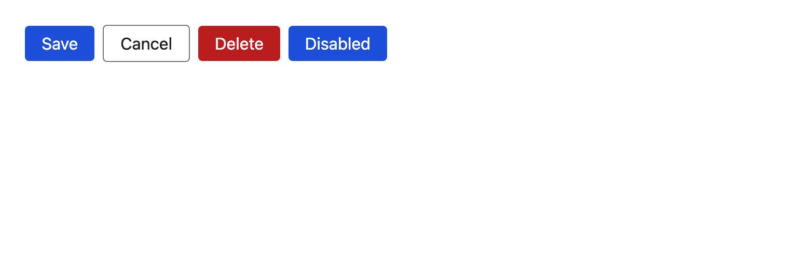

# Button

The only button in the system. Features never render a raw `<button>` — `component-dup-scan` fails the build if they try — so every clickable affordance inherits the same focus ring, spacing and disabled semantics.



## API

| Prop | Type | Default | Notes |
| --- | --- | --- | --- |
| `variant` | `"primary" \| "secondary" \| "danger"` | `"primary"` | Colour only; all three share one geometry. |
| `data-testid` | `string` | — | **Required.** Enforced by the type, not just by lint (BR-02). |
| `type` | `"button" \| "submit" \| "reset"` | `"button"` | Defaults to `button` so a stray button never submits a form by accident. |
| …rest | `ButtonHTMLAttributes` | — | Forwarded to the element, including `disabled` and `onClick`. |

`ref` is forwarded to the underlying `<button>`.

## Accessibility

- Native `<button>`, so Enter/Space, focus order and the AT role come from the platform.
- `disabled` blocks activation and switches the cursor to `not-allowed`; it does **not** hide the button from assistive tech.
- Colours are pre-validated for WCAG 2.2 AA against `tokens.color.bg`; `axe` re-checks the rendered output in E2E.

## i18n

The label is `children` — always a `t()` value from the caller. The component ships no copy of its own, and `local/no-user-facing-literal` rejects `<Button title="Save">`.

```tsx
<Button data-testid="notes-add" onClick={submit}>{t("notes.add")}</Button>
```
