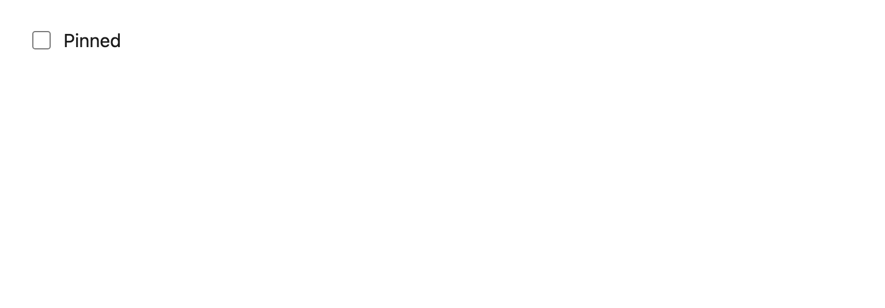

# Checkbox

A native checkbox with its label beside it, sharing `Field`'s id and error wiring so a form can mix text inputs, selects and checkboxes without three different accessibility stories.



## API

| Prop | Type | Notes |
| --- | --- | --- |
| `label` | `string` | **Required**, already translated. Clicking it toggles the box. |
| `error` | `string?` | `""` means no error, as everywhere else. |
| `data-testid` | `string` | **Required.** Label is `<testid>-label`, error is `<testid>-error`. |
| …rest | `InputHTMLAttributes` | Forwarded to the input. `type` is fixed to `checkbox`. |

## Accessibility

- Native input, so Space toggles and the checked state is exposed to assistive tech without ARIA.
- The label is a real `<label htmlFor>`, giving a larger hit target and a correct accessible name.
- `accentColor` comes from `tokens.color.primary`, which is contrast-validated.

## i18n

`label` and `error` are caller-supplied `t()` values.

```tsx
<Checkbox data-testid="notes-pinned" label={t("notes.pinned")} checked={pinned} onChange={onToggle} />
```
