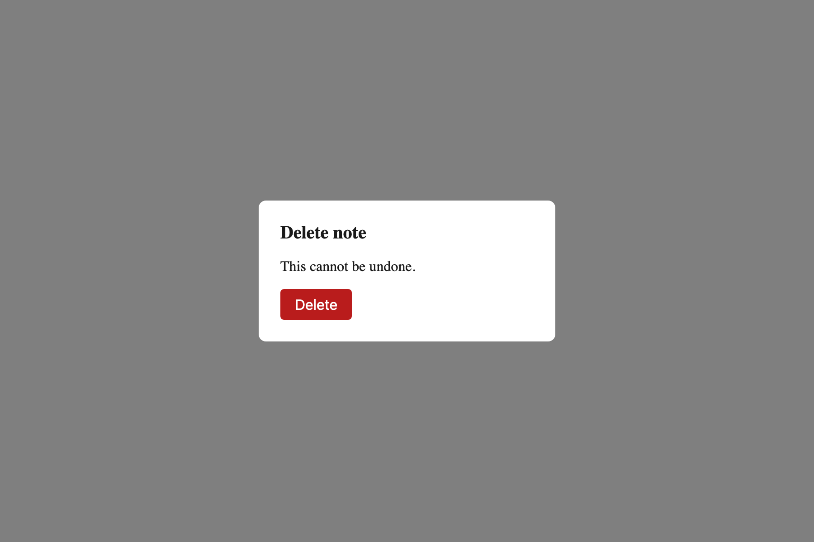
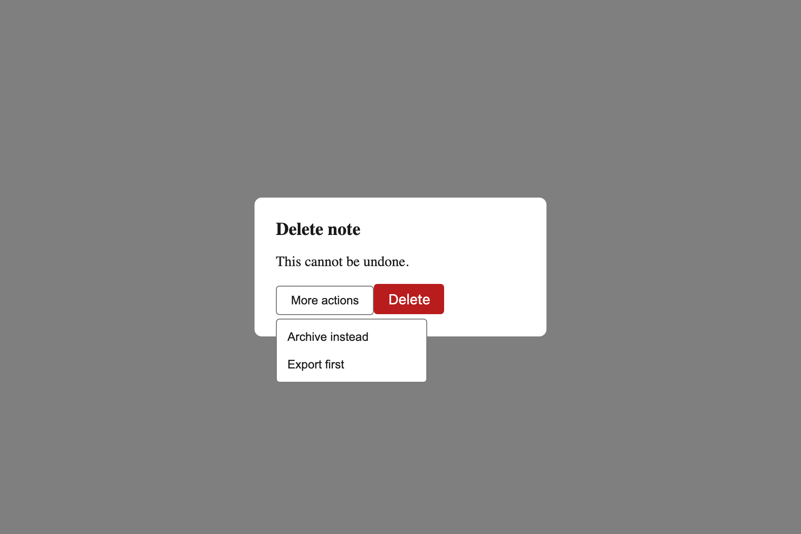
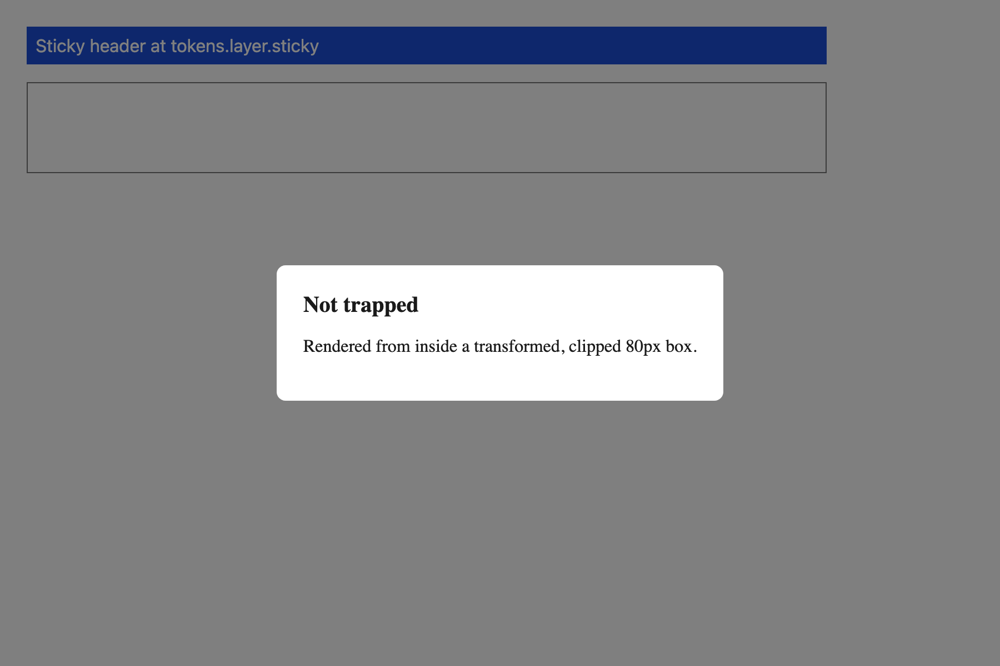

# Dialog

A modal that is genuinely on top. The scrim and the surface both render through `Portal` into a body-level root, so no ancestor `transform`, `filter` or `overflow: hidden` in the application tree can trap or clip them — the failure mode that makes "it worked in isolation" dialogs disappear behind a sticky header.



A menu opened *inside* the dialog draws above it, because `tokens.layer.popover` sits above `tokens.layer.modal`:



Rendered from inside an ancestor with `transform` and `overflow: hidden` — the combination that traps and crops an in-place modal — the portal keeps it whole and on top:



`e2e/overlay.e2e.ts` asserts this against real paint order in Chromium, not against a `zIndex` value.

## API

| Prop | Type | Notes |
| --- | --- | --- |
| `open` | `boolean` | Fully controlled. Closed renders `null`, not a hidden node. |
| `onClose` | `() => void` | Called by Escape, by a scrim click, and by the Radix provider's own affordances. |
| `title` | `string` | **Required**, already translated. Becomes the accessible name and the visible `<h2>`. |
| `data-testid` | `string` | **Required.** Scrim is `<testid>-scrim`, heading is `<testid>-title`. |

## Layering

| Element | Layer | Value |
| --- | --- | --- |
| Scrim | `tokens.layer.overlay` | 1000 |
| Surface | `tokens.layer.modal` | 1010 |

`layer:scan` fails the build on a numeric `zIndex` anywhere, and on a `position: fixed` surface that does not go through a portal.

## Accessibility

- `role="dialog"`, `aria-modal="true"`, and an accessible name from `title`.
- Focus moves to the dialog on open and is restored to the opener on close.
- Tab and Shift+Tab wrap inside the dialog; with no focusable children, focus stays on the container.
- Escape closes. `onClose` is read through a ref, so a parent re-render with a fresh inline handler does not steal focus mid-interaction.

## Providers

`ProtoUIProvider provider="radix"` swaps in `@radix-ui/react-dialog`. Both implementations portal and both carry the same layer values — the same test file asserts it against each.

## i18n

`title` and everything in `children` are caller-supplied `t()` values.

```tsx
<Dialog open={open} onClose={close} data-testid="notes-delete" title={t("notes.delete.title")}>
  <p>{t("notes.delete.body")}</p>
</Dialog>
```
