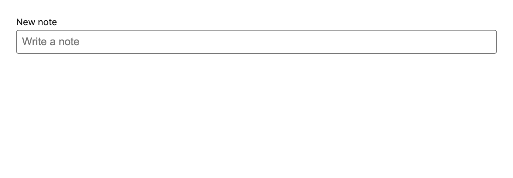
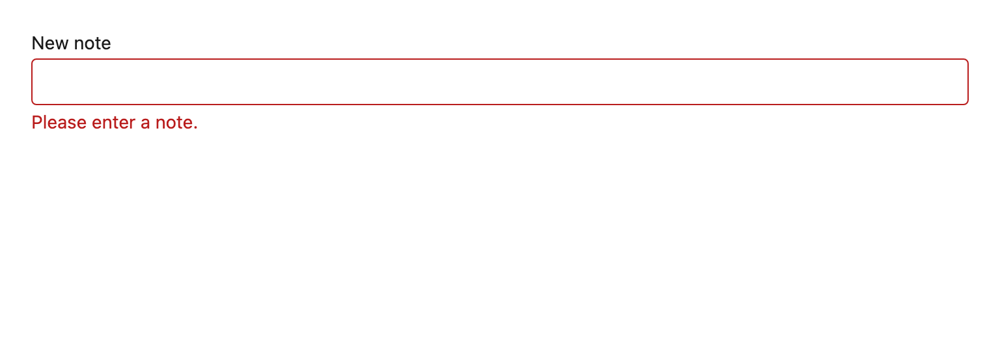

# Field

Label, text input and inline error as one unit, so the three can never drift apart. `useId` generates the id, the label's `htmlFor` and the error's `aria-describedby` from a single source.





## API

| Prop | Type | Notes |
| --- | --- | --- |
| `label` | `string` | **Required**, already translated. Rendered in a real `<label>`, never a placeholder. |
| `error` | `string?` | Empty string counts as "no error" — convenient for controlled forms that reset to `""`. |
| `data-testid` | `string` | **Required.** The label gets `<testid>-label` and the error `<testid>-error`, so all three are addressable. |
| …rest | `InputHTMLAttributes` | Forwarded to the `<input>`. `id` is owned by the component. |

## Accessibility

- `aria-invalid` is set only when there is a real error, and `aria-describedby` points at the message.
- The error is a live `role="alert"`, so it is announced when it appears rather than only on focus.
- A placeholder is never a substitute for the label; both are separate props.

## i18n

`label`, `placeholder` and `error` are all caller-supplied `t()` values. Passing a literal fails lint.

```tsx
<Field
  data-testid="notes-input"
  label={t("notes.field.label")}
  placeholder={t("notes.field.placeholder")}
  error={error}
/>
```
