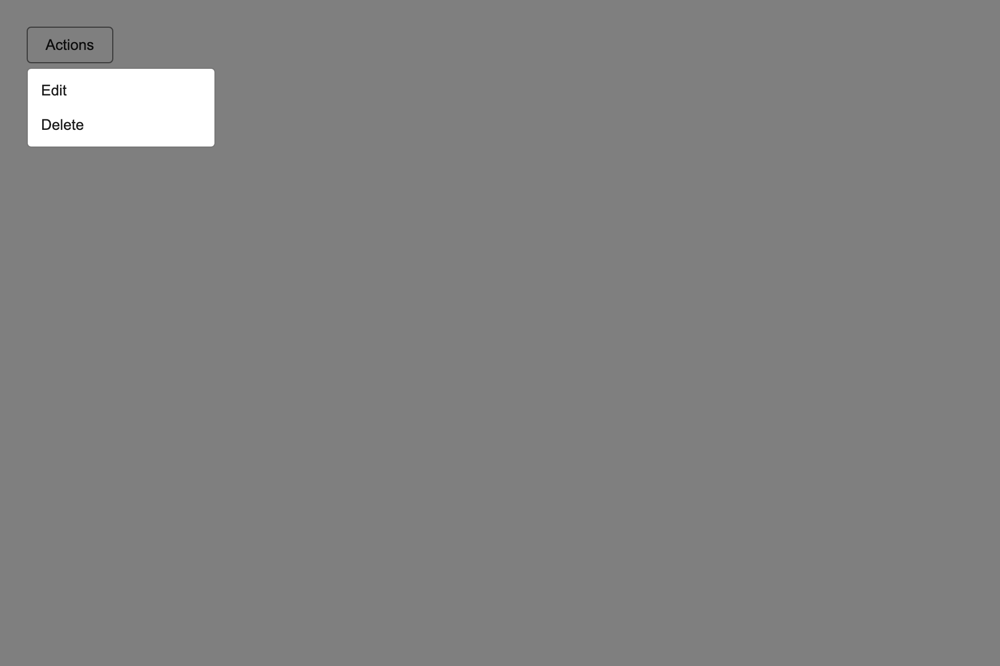

# Menu

A menu button whose surface escapes the app tree. The list renders in the body-level portal and is anchored to the trigger in **viewport** coordinates, because a portalled element has no offset parent to be `position: absolute` against.



## API

| Prop | Type | Notes |
| --- | --- | --- |
| `label` | `string` | **Required**, already translated. Used for the trigger text and the menu's accessible name. |
| `items` | `{ id: string; label: string; onSelect: () => void }[]` | `label` is translated by the caller. An empty array is valid and renders an empty surface. |
| `data-testid` | `string` | **Required.** Trigger `<testid>-trigger`, surface `<testid>-surface`, item `<testid>-item-<id>`. |

## Layering

The surface is promoted into the browser's **top layer**, where paint order is the order
things opened. A menu opened inside a dialog draws above it because it opened later —
and a dialog opened after the menu draws above the menu, which is the case a fixed
per-kind scale used to invert. Both are photographed: the first in
[Dialog](../Dialog/README.md), the second as this component's
`menu-under-later-dialog` harness case.

Nothing here reads `tokens.layer`; the fallback z-index comes from the overlay stack.

## Behaviour

- Opens on trigger click; clicking the trigger again closes it.
- Escape closes; a pointer press anywhere outside the trigger and surface closes.
- Closing returns focus to the trigger.
- Opening moves focus to the first item — necessary once portalled, since the surface sits at the end of the document and would otherwise be at the end of the tab order.
- The anchor is recomputed on `resize` and on `scroll` (captured, so an ancestor scroll counts), rather than drifting away from the trigger.

## Accessibility

`aria-haspopup="menu"` and `aria-expanded` on the trigger; `role="menu"` with `role="menuitem"` children and an accessible name from `label`.

## i18n

```tsx
<Menu
  data-testid="notes-actions"
  label={t("notes.actions.label")}
  items={[{ id: "edit", label: t("notes.actions.edit"), onSelect: edit }]}
/>
```
