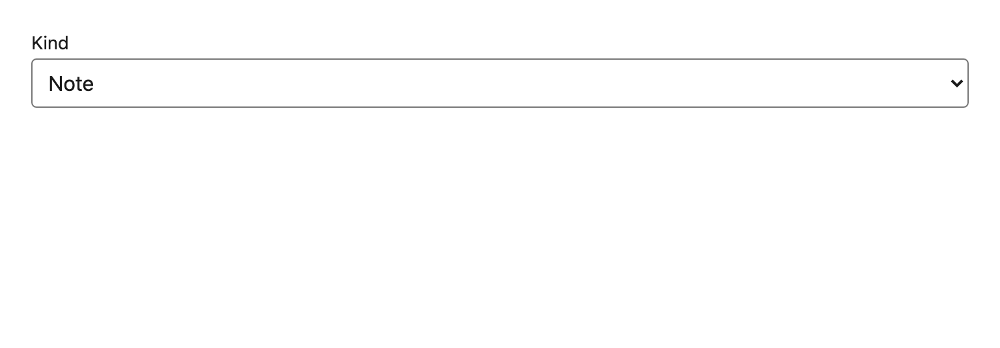

# Select

A native `<select>` on Field's wiring. Native is a deliberate choice: the platform's dropdown already handles typeahead, touch, screen readers and small viewports better than a custom listbox usually manages.



## API

| Prop | Type | Notes |
| --- | --- | --- |
| `label` | `string` | **Required**, already translated. |
| `options` | `readonly { value: string; label: string }[]` | `label` is translated by the caller; `value` is a stable code, never shown. |
| `error` | `string?` | Same contract as `Field` — `""` means no error. |
| `data-testid` | `string` | **Required.** Each option gets `<testid>-option-<value>`. |

## Accessibility

- Label association, `aria-invalid` and `aria-describedby` behave exactly as in `Field`, so a form mixing the two has one a11y story.
- Keyboard and screen-reader behaviour is the browser's, unmodified.

## i18n

Separating `value` from `label` is what makes translation possible: the value is a domain code that must stay stable across locales, the label is a `t()` string.

```tsx
<Select
  data-testid="notes-kind"
  label={t("notes.kind.label")}
  options={KINDS.map((k) => ({ value: k, label: t(`notes.kind.${k}`) }))}
/>
```

That template key is exactly the case `i18n:verify` rejects unless the file declares `// i18n-dynamic: notes.kind.note, notes.kind.task`.
