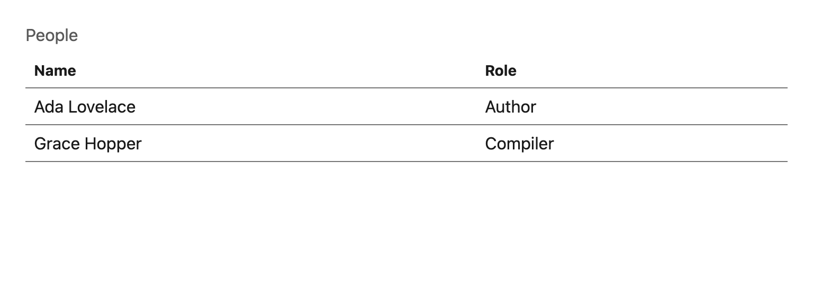
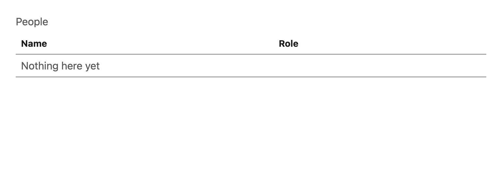

# Table

A semantic data table: real `<caption>`, real scoped `<th>`, and a testid on every structural node so tests address a cell instead of counting rows.

## API

| Prop | Type | Notes |
| --- | --- | --- |
| `caption` | `string` | **Required**, already translated. Visible, not hidden — it is what tells a reader what the table is. |
| `columns` | `{ key, header, render? }[]` | `header` is translated by the caller; `render` supplies a custom cell. |
| `rows` | `T[]` | — |
| `rowKey` | `(row: T) => string` | The stable identity used for React keys **and** for every cell testid. |
| `emptyLabel` | `string` | **Required** — the empty state is UI copy like any other and must be translated. |
| `data-testid` | `string` | **Required.** See the testid map below. |

## Testid map

| Node | Testid |
| --- | --- |
| `<table>` | `<testid>` |
| `<caption>` | `<testid>-caption` |
| header cell | `<testid>-header-<columnKey>` |
| row | `<testid>-row-<rowKey>` |
| cell | `<testid>-cell-<rowKey>-<columnKey>` |
| empty cell | `<testid>-empty` |

Because row and cell ids are derived from `rowKey`, they are unique by construction — the runtime uniqueness assertion in `src/test/setup.ts` covers the case where `rowKey` is not actually unique.

## Accessibility

- `<th scope="col">` on every header, so a screen reader announces the column when reading a cell.
- The empty state is a real row spanning all columns, not an absence, so the table structure stays valid.

## i18n

`caption`, every `header`, and `emptyLabel` are caller-supplied `t()` values. `emptyLabel` is required precisely because an optional one defaulted to a dash and quietly shipped untranslated.
