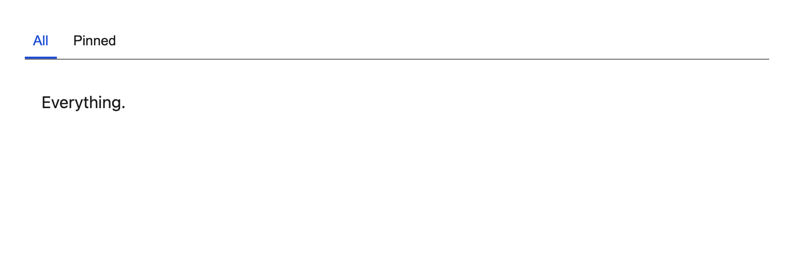

# Tabs

Tablist, tabs and panels with roving tabindex and arrow-key navigation. All testids are namespaced by the component's own testid, so two `Tabs` on one page cannot collide.



## API

| Prop | Type | Notes |
| --- | --- | --- |
| `tabs` | `{ id: string; label: string; content: ReactNode }[]` | `label` is translated by the caller; `id` is a stable code used in testids. |
| `data-testid` | `string` | **Required.** Tablist `<testid>-tablist`, tab `<testid>-tab-<id>`, panel `<testid>-panel-<id>`. |

Selection is internal state. The first tab is selected on mount.

## Accessibility

- `role="tablist"` / `role="tab"` / `role="tabpanel"`, with `aria-controls` and `aria-labelledby` linking each pair through `useId`-generated ids.
- Roving tabindex: only the selected tab is in the tab order; ArrowLeft/ArrowRight move selection and wrap at both ends.
- Unselected panels are `hidden`, so they are removed from the accessibility tree rather than merely invisible.

## i18n

```tsx
<Tabs
  data-testid="notes-filter"
  tabs={[
    { id: "all", label: t("notes.filter.all"), content: <AllNotes /> },
    { id: "pinned", label: t("notes.filter.pinned"), content: <PinnedNotes /> },
  ]}
/>
```
