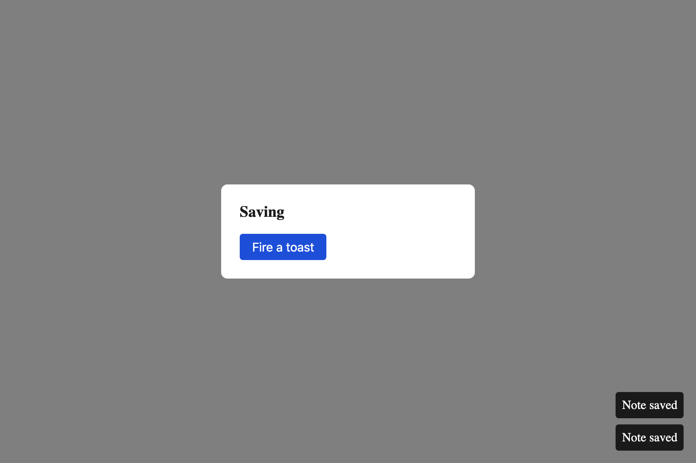

# ToastProvider

Transient notifications in a live region, portalled to the top of the layer scale so a toast raised from inside a modal is still seen and still announced.


Raised from inside a modal, it still draws above it:



## API

| Prop | Type | Notes |
| --- | --- | --- |
| `label` | `string` | **Required**, already translated. The accessible name of the notification region. |
| `duration` | `number` | Milliseconds before auto-dismiss. Default `4000`. |
| `children` | `ReactNode` | The subtree that may call `useToast()`. |

```ts
const { notify } = useToast();
notify(message: string, tone?: "info" | "error"): void
```

`useToast` throws outside a provider rather than silently doing nothing.

## Why `label` is required

It used to be hard-coded to `"Notifications"` inside the library. That single English string shipped in every prototype and passed every gate, because no check looked inside `packages/proto-ui`. It is now a required prop, `eslint-plugin-i18next` and `local/no-user-facing-literal` run over the library too, and the library owns no user-visible copy at all.

## Layering

`tokens.layer.toast` (1200) — above `modal` and above `popover`. A notification is the one thing allowed to draw over a blocking surface, because it may be the reason the surface should close.

## Accessibility

- Region has `role="region"` with the caller's accessible name.
- `tone: "error"` renders `role="alert"` (assertive); `info` renders `role="status"` (polite).
- Each toast has its own testid, `toast-<id>`, so several at once stay individually addressable.

## i18n

`label` and every `message` are caller-supplied `t()` values:

```tsx
<ToastProvider label={t("app.notifications")}>…</ToastProvider>
notify(t("notes.saved"));
```
