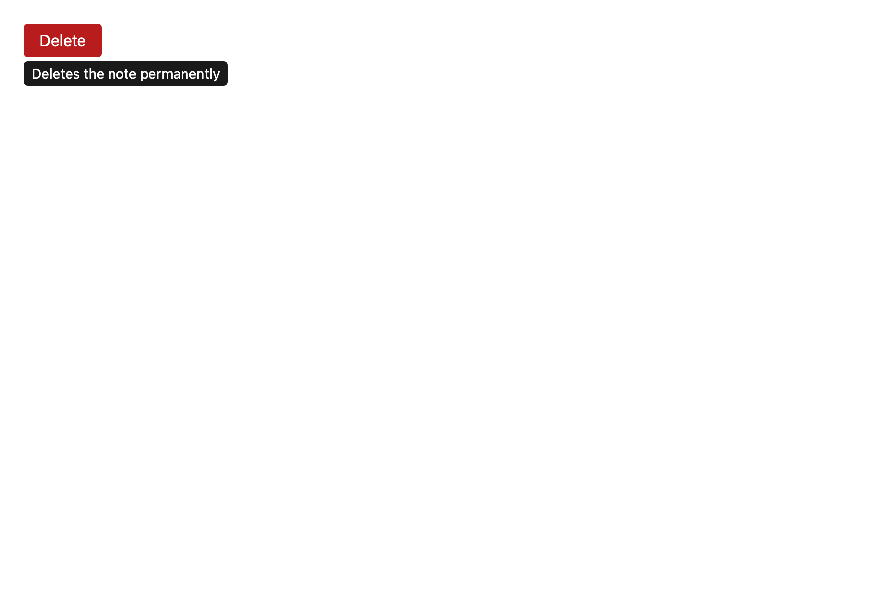

# Tooltip

A description that appears beside the control it describes, promoted into the browser's
**top layer** like every other surface — so it paints above whatever was already open,
including a toast.



## API

| Prop | Type | Notes |
| --- | --- | --- |
| `label` | `string` | **Required**, already translated. The description text. |
| `children` | `ReactElement` | The control being described. Cloned to receive `aria-describedby`. |
| `data-testid` | `string` | **Required.** Trigger wrapper is `<testid>-trigger`, surface is `<testid>-surface`. |

## What it deliberately does NOT do

A tooltip is defined as much by what it must not do, so it composes only four of the
`overlay/` modules and pointedly not the rest (NFR-23 — a consumer does not depend on
what it does not use):

| Composed | Not composed | Why not |
| --- | --- | --- |
| `useOverlaySlot` | `useFocusScope` | It must never take or trap focus. A tooltip that steals focus cannot be read by the person who triggered it. |
| `promote` / `demote` | `useScrollLock` | It does not block the page. |
| `useAnchor` | `useInertBackground` | Same. |
| `useDismiss` (Escape only) | — | Outside-pointer dismissal is off: pointer-leave already covers it, and claiming outside clicks would let a tooltip swallow a click meant for a dialog underneath. |

The surface carries `pointer-events: none`. A tooltip that intercepts clicks breaks the
control it is describing.

## Accessibility

- `role="tooltip"` on the surface, with an `id` referenced by the control's
  `aria-describedby` while it is showing — and removed when it is not.
- **`aria-describedby` goes on the control, not on the wrapper.** A screen reader
  announces the description of the element that has focus, and the wrapper is not it.
  That is the reason the child is cloned rather than merely wrapped.
- Shows on `pointerenter` **and** on `focus`, so it is reachable without a pointer.
- Escape dismisses it. A tooltip that will not go away is worse than no tooltip.
- Focus never moves, which the tests assert directly.
- VoiceOver smoke: focusing the control announces its name followed by the description.

## i18n

`label` is a caller-supplied `t()` value; the library owns no copy of its own (BR-08).

```tsx
<Tooltip label={t("notes.delete.hint")} data-testid="notes-delete-hint">
  <Button data-testid="notes-delete" variant="danger" onClick={remove}>
    {t("notes.delete.action")}
  </Button>
</Tooltip>
```
